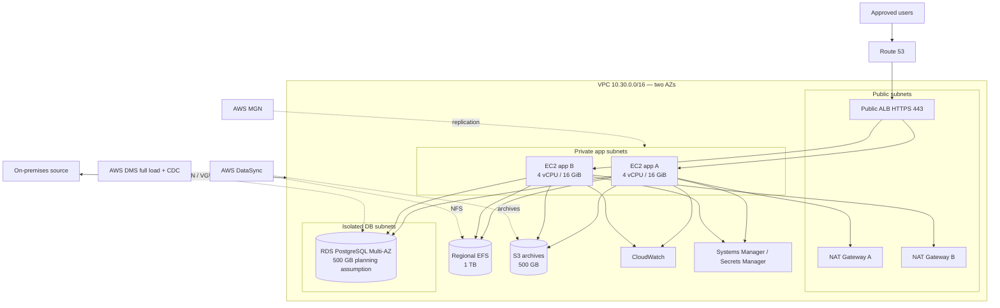

# Clafoke Investors Ltd — AWS Cloud Migration Blueprint

> Fictional portfolio case study. Design-only. Not deployed.

A cloud migration blueprint for a fictional Nigerian retail/distribution company and its order-management platform. All company details, workload figures, targets and capacities are illustrative assumptions—not measured production facts.

## Baseline

| Item | Design assumption |
|---|---|
| Region | `us-east-1` |
| VPC | `10.30.0.0/16`, two AZs |
| Subnets | 2 public, 2 private app, 2 isolated DB |
| Application | 2 Linux servers, 4 vCPU / 16 GiB each, EC2 |
| Database | PostgreSQL to RDS Multi-AZ; 500 GB planning storage |
| Shared files | 1 TB Regional EFS |
| Archives | 500 GB S3 Standard |
| Hybrid | 1 Site-to-Site VPN using VGW design |
| Entry | Public ALB, HTTPS 443 |
| Business targets | 99.9% availability; RTO 4h; RPO 15m—not demonstrated |

## Architecture

Migration services are temporary migration paths, not permanent runtime components. S3 Gateway Endpoint is preferred where appropriate; interface endpoints are added only when justified.

## Deliverables

1. [Discovery assessment](docs/01-discovery-assessment.md)
2. [Target architecture](docs/02-target-architecture.md)
3. [Network and security design](docs/03-network-security-design.md)
4. [Data migration strategy](docs/04-data-migration-strategy.md)
5. [Migration runbook](docs/05-migration-runbook.md)
6. [Validation and rollback](docs/06-validation-rollback-strategy.md)
7. [Cost estimate and optimisation](docs/07-cost-estimation-optimisation.md)

Additional assets: `architecture/target-architecture.mmd`, `cost/pricing-assumptions.csv`, `evidence/README.md`, `DESIGN-CONSISTENCY.md`.

## Cost headline

Illustrative steady-state estimate: **USD $2,099–$2,587/month** (730 hours/month). RDS Multi-AZ compute and backup allowances are provisional. This is not an AWS quote; use AWS Pricing Calculator with exact instance classes, Region and configuration before budget approval.

## Important limitations

No AWS resources have been provisioned; no MGN replication, DMS migration, DataSync transfer, cutover, rollback, performance test or recovery test has occurred. RTO/RPO and availability are targets, not results. Cost excludes taxes, support plan, engineering labour and several usage-dependent charges.

## Suggested review sequence

Read discovery and assumptions, compare architecture with network/security, review migration and runbook, review validation/rollback, then refresh the cost model. Do not describe this as an actual customer migration or deployed system.
