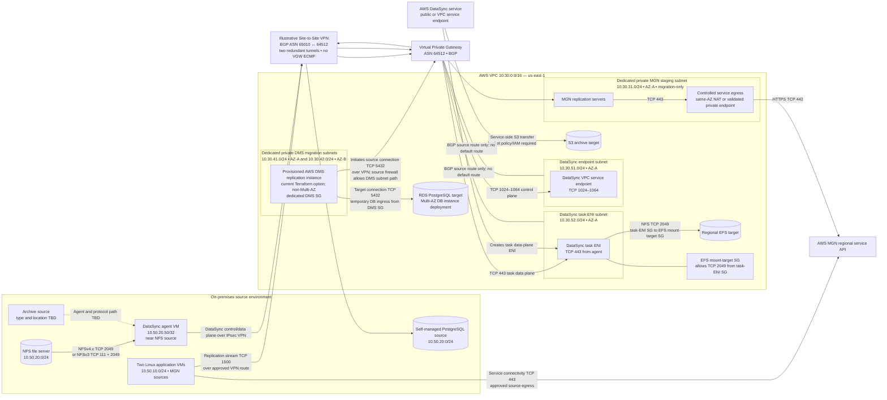

# Migration Data-Flow View

**ID:** CLI-AWS-VIEW-012 | **Version:** 1.1 | **Status:** Proposed — not executed

This focused view separates MGN, DMS and DataSync paths so their distinct source, destination, protocols and dependencies can be reviewed independently. It complements the [canonical master architecture](target-architecture.md).

## Rendered migration-flow diagram

## Migration path summary

| Workstream | Source to destination | Main path / protocol | Important boundary |
|---|---|---|---|
| AWS MGN | Two Linux application VMs to MGN staging replication servers | Source-to-staging TCP 1500 over approved VPN route; source and staging service connectivity TCP 443 | Dedicated private staging subnet; controlled service egress; staging CIDR/AZ and sizing pending |
| AWS DMS | Self-managed PostgreSQL to RDS PostgreSQL | DMS-to-source TCP 5432 over VPN; DMS-to-target TCP 5432 | DMS replication subnet group spans dedicated DMS-A/B subnets in two AZs; current provisioned replication instance is non-Multi-AZ; dedicated DMS SG; temporary RDS ingress from DMS SG |
| DataSync NFS | On-premises NFS to Regional EFS | Agent-to-NFS TCP 2049 for NFSv4.x or TCP 111 + 2049 for NFSv3; DataSync task ENI to EFS TCP 2049 | Agent near source; task ENI in same VPC and AZ as selected EFS mount target; dedicated task-ENI SG |
| DataSync archive | Archive source to S3 | DataSync service-side transfer | Archive source type/location and agent requirement are unknown; do not assume NFS or a particular source connector |

## Service-specific validation gates

### MGN

- Confirm supported source OS, architecture, boot mode, disk inventory and change rate.
- Allocate a dedicated private staging subnet with non-overlapping CIDR and adequate IP capacity.
- Validate source-to-staging TCP 1500 and source/staging-to-regional-service TCP 443.
- Confirm controlled staging egress through same-AZ NAT or a separately validated private endpoint design.
- Size replication servers, EBS and snapshots from measured source profiles; no migration runtime or staging cost is approved.

### DMS

- Capture exact PostgreSQL source and target versions and verify current DMS compatibility.
- Approve schema/object migration separately from row-data movement.
- Validate logical WAL, replication permissions, slots/senders, WAL headroom, table keys and replica identity.
- Benchmark provisioned versus Serverless capacity and record full-load duration and CDC lag.
- Allow TCP 5432 from DMS to the source path and target DB SG; remove temporary DMS ingress after migration when no longer needed.
- Reconcile PostgreSQL sequences after CDC stops; ongoing DMS replication does not synchronise sequence state.

### DataSync

- Confirm NFS version, agent mode, endpoint type and the corresponding service endpoint port model.
- Validate agent-to-source NFS ports and agent-to-service connectivity.
- For EFS, verify task ENI placement in a subnet/AZ with an EFS mount target and TCP 2049 from task-ENI SG to EFS mount-target SG.
- Inventory archive source type, location, bytes and connector/agent requirements before pricing or execution.
- Record initial transfer reports and final-delta reconciliation after writers/jobs are paused.

## Unknowns retained explicitly

Source CIDRs and VPN route mode, MGN staging subnet CIDR/AZ, exact PostgreSQL versions, DMS sizing/runtime, DataSync task mode and service endpoint, archive source type/bytes, final delta, transfer window and cutover sequencing remain pending validation. The diagram does not claim that any migration service has been configured or run.

## Canonical source

The editable Mermaid source for this view is [migration-data-flow.mmd](migration-data-flow.mmd). Keep the embedded Mermaid block above synchronised with that file.

## Related views

- [Runtime/network view](runtime-network-view.md)
- [Canonical master architecture](target-architecture.md)
- [Network and security design](../docs/03-network-security-design.md)
- [Data migration strategy](../docs/04-data-migration-strategy.md)
- [Migration runbook](../docs/05-migration-runbook.md)
- [Migration readiness matrix](../docs/09-migration-readiness-matrix.md)
