# Runtime Architecture and Network View

**ID:** CLI-AWS-VIEW-011 | **Version:** 1.1 | **Status:** Proposed — not deployed

This view reconciles the customer-facing runtime, migration-service subnets, route-table propagation and security-group intent with the current Terraform network baseline. It complements, but does not replace, the [canonical master architecture](target-architecture.md).

## Rendered runtime/network diagram

```mermaid
flowchart TB
  USERS["Approved users"] --> DNS["Public DNS<br/>Authoritative provider TBD"]

  subgraph VPC["VPC 10.30.0.0/16 — us-east-1 — two Availability Zones"]
    IGW["Internet Gateway"]
    VGW["Virtual Private Gateway<br/>BGP ASN 64512<br/>Site-to-Site VPN"]
    
    subgraph PUB_A["AZ-A — Public subnet 10.30.1.0/24"]
      ALB_A["ALB node A<br/>HTTPS listener 443"]
      NAT_A["NAT Gateway A"]
    end
    subgraph PUB_B["AZ-B — Public subnet 10.30.2.0/24"]
      ALB_B["ALB node B<br/>HTTPS listener 443"]
      NAT_B["NAT Gateway B"]
    end

    ALB["Internet-facing ALB<br/>public HTTPS 443"]
    DNS -->|"DNS resolves to ALB DNS name"| ALB
    IGW -->|"Internet ingress via public subnet routes"| ALB
    ALB -.->|"Subnet mapping / ALB ENI — AZ-A"| ALB_A
    ALB -.->|"Subnet mapping / ALB ENI — AZ-B"| ALB_B

    subgraph APP_A["AZ-A — Private app subnet 10.30.11.0/24"]
      APP_EC2_A["EC2 application A<br/>ASG member"]
      EFS_MTA["EFS mount target A"]
    end
    subgraph APP_B["AZ-B — Private app subnet 10.30.12.0/24"]
      APP_EC2_B["EC2 application B<br/>ASG member"]
      EFS_MTB["EFS mount target B"]
    end

    subgraph DB_A["AZ-A — Isolated DB subnet 10.30.21.0/24"]
      DB_PRIMARY["RDS PostgreSQL<br/>Multi-AZ DB instance primary"]
    end
    subgraph DB_B["AZ-B — Isolated DB subnet 10.30.22.0/24"]
      DB_STANDBY["RDS PostgreSQL<br/>Multi-AZ standby"]
    end

    subgraph MGN_STAGING["AZ-A — MGN staging subnet 10.30.31.0/24"]
      MGN_REPL["MGN replication servers<br/>single-AZ staging design"]
    end

    subgraph DMS_A["AZ-A — Dedicated DMS subnet 10.30.41.0/24"]
      DMS_SUBNET_A["DMS subnet-group member A"]
    end
    subgraph DMS_B["AZ-B — Dedicated DMS subnet 10.30.42.0/24"]
      DMS_SUBNET_B["DMS subnet-group member B"]
    end
    DMS["Provisioned DMS replication instance<br/>private; non-Multi-AZ Terraform baseline<br/>dedicated DMS SG"]

    EFS["Regional EFS<br/>1 TB planning assumption"]
    subgraph DS_ENDPOINT_SUBNET["AZ-A — DataSync endpoint subnet 10.30.51.0/24"]
      DS_EP["DataSync VPC service endpoint<br/>TCP 1024–1064 from agent"]
    end
    subgraph DS_TASK_SUBNET["AZ-A — DataSync task subnet 10.30.52.0/24"]
      DS_TASK["DataSync task ENI<br/>TCP 443 from agent; TCP 2049 to EFS"]
    end
    S3EP["S3 Gateway Endpoint<br/>prefix-list route"]
    S3["S3 Standard archive target<br/>500 GB capacity assumption"]
    OPS["PrivateLink candidates — conditional<br/>SSM / ssmmessages / Secrets Manager<br/>CloudWatch Logs / Monitoring"]

    ALB_A --> APP_EC2_A
    ALB_A --> APP_EC2_B
    ALB_B --> APP_EC2_A
    ALB_B --> APP_EC2_B
    APP_EC2_A -->|"TCP 5432 — application SG to DB SG"| DB_PRIMARY
    APP_EC2_B -->|"TCP 5432 — application SG to DB SG"| DB_PRIMARY
    DB_PRIMARY <-->|"Multi-AZ synchronous standby relationship"| DB_STANDBY
    APP_EC2_A -->|"TCP 2049 — application SG to EFS mount-target SG"| EFS_MTA
    APP_EC2_B -->|"TCP 2049 — application SG to EFS mount-target SG"| EFS_MTB
    EFS_MTA --- EFS
    EFS_MTB --- EFS
    DS_TASK -->|"TCP 2049 — task-ENI SG to EFS mount-target SG"| EFS_MTA
    APP_EC2_A --> S3EP
    APP_EC2_B --> S3EP
    S3EP --> S3
    APP_EC2_A --> OPS
    APP_EC2_B --> OPS
    APP_EC2_A -->|"Default route via same-AZ NAT"| NAT_A
    APP_EC2_B -->|"Default route via same-AZ NAT"| NAT_B
    NAT_A --> IGW
    NAT_B --> IGW

    MGN_REPL -->|"Controlled TCP 443 service egress"| NAT_A
    DMS_SUBNET_A --- DMS
    DMS_SUBNET_B --- DMS
    DMS -->|"TCP 5432 — temporary target access"| DB_PRIMARY
    DMS -->|"Source TCP 5432 over VPN"| VGW
  end

  ONPREM["Illustrative on-premises<br/>10.50.0.0/16<br/>App 10.50.10.0/24<br/>DB/NFS 10.50.20.0/24<br/>DataSync agent 10.50.20.50/32"] ---|"IPsec VPN • BGP ASN 65010 ↔ 64512<br/>two tunnels • VGW no ECMP"| VGW
  ONPREM -->|"MGN replication TCP 1500"| VGW
  VGW -->|"BGP source route"| MGN_REPL
  VGW -->|"DMS source TCP 5432"| DMS
  ONPREM -->|"TCP 1024–1064 control plane<br/>TCP 443 task data plane"| VGW
  VGW --> DS_EP
  VGW --> DS_TASK

  subgraph ROUTING["Route-table intent — proposed, not deployed"]
    R1["Public A/B: default route to IGW"]
    R2["App A/B: same-AZ NAT default + S3 Gateway Endpoint<br/>No VGW propagation"]
    R3["DB A/B: VPC-local routes only<br/>No IGW, NAT or VGW propagation"]
    R4["MGN staging 10.30.31.0/24: BGP source route + same-AZ NAT default<br/>S3 Gateway Endpoint association"]
    R5["DMS A/B 10.30.41.0/24 and 10.30.42.0/24:<br/>BGP source route + same-AZ NAT default"]
    R6["DataSync endpoint 10.30.51.0/24 and task 10.30.52.0/24:<br/>BGP source route only; no default route"]
  end

  subgraph SECURITY["Security-group intent — proposed, not deployed"]
    SG1["ALB SG: public HTTPS 443 ingress<br/>egress to App SG on target port 8080"]
    SG2["App SG: TCP 8080 from ALB SG only<br/>egress TCP 5432 to RDS SG; TCP 2049 to EFS SG"]
    SG3["DB SG: TCP 5432 from App SG<br/>and temporary DMS SG during migration"]
    SG4["EFS mount-target SG: TCP 2049<br/>from App SG and DataSync task-ENI SG"]
    SG5["DMS SG: no inbound by default<br/>all-outbound baseline; peer ingress and routes remain scoped"]
    SG6["MGN staging SG: TCP 1500 from source app CIDR<br/>TCP 443 controlled egress"]
    SG7["DataSync endpoint SG: TCP 1024–1064 from agent /32<br/>Task ENI SG: TCP 443 from agent /32; egress TCP 2049 to EFS SG"]
  end
```

## Subnet inventory

The VPC contains **11 subnets: six steady-state and five migration-only**. CIDRs and AZ labels are synthetic portfolio assumptions; resolve the AZ names to account-specific AZ IDs before any real deployment.

| Logical subnet | CIDR | AZ | Route-table intent | Purpose |
|---|---|---|---|---|
| Public-A | `10.30.1.0/24` | AZ-A | Default to IGW | ALB node and NAT-A |
| Public-B | `10.30.2.0/24` | AZ-B | Default to IGW | ALB node and NAT-B |
| App-A | `10.30.11.0/24` | AZ-A | Same-AZ NAT default; S3 Gateway Endpoint | Application ASG |
| App-B | `10.30.12.0/24` | AZ-B | Same-AZ NAT default; S3 Gateway Endpoint | Application ASG |
| DB-A | `10.30.21.0/24` | AZ-A | VPC-local only | RDS subnet group |
| DB-B | `10.30.22.0/24` | AZ-B | VPC-local only | RDS subnet group |
| MGN staging | `10.30.31.0/24` | AZ-A | BGP source route; NAT-A default; S3 endpoint association | MGN replication servers |
| DMS-A | `10.30.41.0/24` | AZ-A | BGP source route; NAT-A default | DMS replication subnet group |
| DMS-B | `10.30.42.0/24` | AZ-B | BGP source route; NAT-B default | DMS replication subnet group |
| DataSync endpoint | `10.30.51.0/24` | AZ-A | BGP source route only; no default | DataSync Interface VPC endpoint |
| DataSync task | `10.30.52.0/24` | AZ-A | BGP source route only; no default | DataSync task ENIs |

## Route-table and propagation baseline

| Route-table group | Intended routes | Propagation boundary |
|---|---|---|
| Public A/B | `0.0.0.0/0 → IGW` | No VGW propagation |
| App A/B | `0.0.0.0/0 → same-AZ NAT`; S3 prefix-list route → S3 Gateway Endpoint | **No VGW propagation**; application subnets do not receive the on-premises aggregate |
| DB A/B | VPC-local route only | No IGW, NAT default or VGW propagation |
| MGN staging | `10.50.0.0/16 → VGW` (BGP); `0.0.0.0/0 → NAT-A`; S3 Gateway Endpoint association | VGW propagation enabled only on RT-MGN |
| DMS-A/B | `10.50.0.0/16 → VGW` (BGP); same-AZ NAT default | VGW propagation enabled only on RT-DMS-A and RT-DMS-B |
| DataSync endpoint/task | `10.50.0.0/16 → VGW` (BGP); no default route | VGW propagation enabled only on the endpoint and task route tables |

The exact five route tables receiving VGW propagation are **RT-MGN, RT-DMS-A, RT-DMS-B, RT-DATASYNC-ENDPOINT and RT-DATASYNC-TASK**. The application and database route tables do not receive the customer aggregate. Route propagation makes a prefix routable; it does not authorize traffic. Security groups, NACLs and customer firewalls remain separate controls.

The S3 Gateway Endpoint is associated with App-A, App-B and MGN staging. It does not imply that application route tables receive BGP routes.

## Security boundaries and allowed paths

| Source | Destination | Protocol | Intended control |
|---|---|---|---|
| Internet clients | ALB | TCP 443 | Public HTTPS listener; current Terraform ingress is `0.0.0.0/0` |
| ALB SG | Application SG | TCP 8080 | App SG accepts only from ALB SG |
| Application SG | RDS SG | TCP 5432 | Stateful application-to-database path |
| Application SG | EFS mount-target SG | TCP 2049 | Stateful application NFS path |
| DMS SG | RDS SG | TCP 5432 | Temporary migration-only target access; remove when no longer required |
| DMS subnet | On-prem PostgreSQL source | TCP 5432 | Source firewall restricts to DMS-A/B CIDRs |
| On-prem application source CIDR | MGN staging SG | TCP 1500 | MGN replication stream |
| MGN staging SG | Regional MGN service dependencies | TCP 443 | Controlled service egress via same-AZ NAT |
| DataSync agent `10.50.20.50/32` | DataSync VPC endpoint SG | TCP 1024–1064 | Dedicated endpoint control plane |
| DataSync agent `10.50.20.50/32` | DataSync task ENI SG | TCP 443 | Task data plane |
| DataSync task ENI SG | EFS mount-target SG | TCP 2049 | Task ENI NFS access |
| DMS SG | Required destinations | All outbound | Current AWS DMS all-outbound baseline; restrict peer ingress and route scope |

The DMS security group has no unsolicited inbound rule by default. Its all-outbound baseline is intentional and must be reviewed against the selected DMS mode and current AWS guidance. The MGN staging security group accepts TCP 1500 only from the synthetic source application CIDR and permits controlled TCP 443 egress. No DBA security-group path is defined in the current Terraform baseline; add one only after an explicit access requirement and design review.

## Placement and availability notes

- The internet-facing ALB spans the two public subnets.
- The Auto Scaling Group spans the two private application subnets, initially one instance per AZ.
- Regional EFS has a mount target in each application AZ.
- RDS PostgreSQL is a Multi-AZ **DB instance deployment**, not a Multi-AZ DB cluster.
- Each application AZ uses its same-AZ NAT Gateway for normal internet egress.
- MGN staging is a single-AZ AZ-A design; it is not an HA claim.
- The DMS replication subnet group spans dedicated DMS-A/B subnets, but the current Terraform replication instance has `multi_az = false`. The two-AZ subnet group does not make the instance itself Multi-AZ.
- The DataSync endpoint and task ENI subnets are both in AZ-A. The task subnet is aligned with EFS mount target A.

## Limitations and validation status

This is a proposed logical view, not a deployed route-table export or security-group configuration. CIDRs, AZ labels, source prefixes and service placement are synthetic. No AWS resources, connectivity tests, VPN failover tests or migration tasks have been executed. Confirm AZ IDs, source CIDRs, customer-gateway/BGP inputs, workload listener, service endpoint requirements and owner approvals before implementation.

## Canonical source

The editable Mermaid source is [runtime-network-view.mmd](runtime-network-view.mmd). The embedded Mermaid block above is kept synchronised with that source.

## Related views

- [Migration data-flow view](migration-data-flow.md)
- [Canonical master architecture](target-architecture.md)
- [Network and security design](../docs/03-network-security-design.md)
- [Network configuration specification](../docs/13-network-configuration-specification.md)
