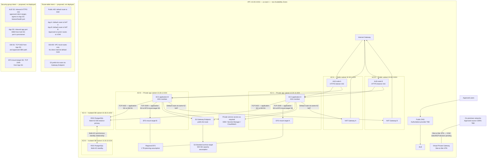

# Runtime Architecture and Network View

**ID:** CLI-AWS-VIEW-011 | **Version:** 1.0 | **Status:** Proposed — not deployed

This focused view isolates the steady-state customer-facing workload, AZ/subnet placement, route-table intent and security-group boundaries. It complements, but does not replace, the [canonical master architecture](target-architecture.md).

## Rendered runtime/network diagram

## Subnet and route-table baseline

| Segment | AZ-A | AZ-B | Route intent |
|---|---|---|---|
| Public | `10.30.1.0/24` | `10.30.2.0/24` | Default route to IGW; ALB and one NAT Gateway per AZ |
| Private application | `10.30.11.0/24` | `10.30.12.0/24` | Same-AZ NAT default route; approved on-premises routes to VGW |
| Isolated database | `10.30.21.0/24` | `10.30.22.0/24` | VPC-local routes only; no direct internet default route |
| MGN staging | Additional private CIDR to allocate | AZ selection pending | Migration-only; controlled TCP 443 service egress and source TCP 1500 route |

The six steady-state subnets are the public, application and database pairs. The MGN staging subnet is an additional seventh migration-only subnet. DMS reuses the two private application subnets for a replication subnet group spanning two AZs; it does not imply a new subnet.

## Security boundaries and allowed paths

| Source | Destination | Protocol | Intended control |
|---|---|---|---|
| Approved clients | ALB | TCP 443 | ALB SG inbound allowlist; ACM certificate |
| ALB SG | Application SG | TCP 8080 (provisional) | App SG accepts only from ALB SG |
| Application SG | RDS DB SG | TCP 5432 | DB SG accepts application traffic; DBA path separately approved |
| Application SG | EFS mount-target SG | TCP 2049 | EFS SG accepts application SG |
| Application subnets | Internet egress | As required, HTTPS preferred | Same-AZ NAT route; application egress policy |
| Application subnets | S3 | HTTPS through S3 Gateway Endpoint | Prefix-list route and restrictive IAM/bucket policy |
| On-premises networks | AWS VPC | Approved VPN routes | VGW; source CIDRs and static/BGP choice remain pending |

No public SSH or public PostgreSQL access is intended. Interface endpoints (for example, Systems Manager, Secrets Manager and CloudWatch) are candidates, not a final deployed endpoint inventory. Add only endpoints justified by workload dependencies and price their AZ coverage and traffic.

## Placement and availability notes

- The internet-facing ALB spans the two public subnets.
- The Auto Scaling Group spans the two private application subnets, with an initial desired/minimum capacity of two instances, one per AZ. Scaling maximum and policy remain subject to workload discovery.
- Regional EFS has a mount target in each application AZ.
- RDS PostgreSQL is a Multi-AZ **DB instance deployment** with one standby in the other DB AZ; it is not a Multi-AZ DB cluster.
- Each application AZ uses its same-AZ NAT Gateway to avoid a cross-AZ NAT dependency in the normal egress path.
- The actual AZ IDs, VPN route mode, source CIDRs, app listener port and DBA access path must be confirmed before implementation.

## Limitations

This is a proposed logical network view, not a deployed route-table export or security-group configuration. Exact route-table IDs, NACL rules, customer-gateway details, VPN tunnel routes, endpoint inventory, AZ IDs and CIDR for the MGN staging subnet remain open decisions. No connectivity or failover test has been executed.

## Canonical source

The editable Mermaid source for this view is [runtime-network-view.mmd](runtime-network-view.mmd). Keep the embedded Mermaid block above synchronised with that file.

## Related views

- [Migration data-flow view](migration-data-flow.md)
- [Canonical master architecture](target-architecture.md)
- [Network and security design](../docs/03-network-security-design.md)
- [Target architecture decisions](../docs/02-target-architecture.md)
