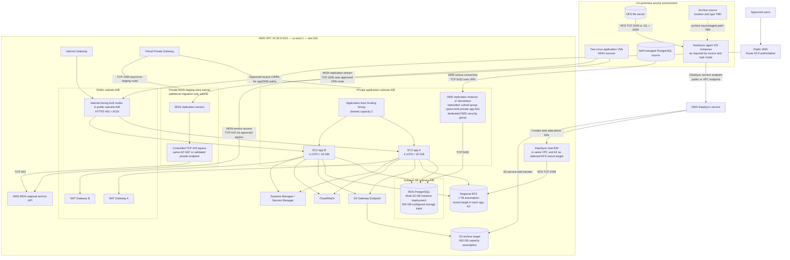

# Target Architecture — Rendered Mermaid Diagram

This page renders the current target architecture in GitHub's Markdown viewer. The source file is [target-architecture.mmd](target-architecture.mmd). Keep this Mermaid block synchronised with the source file when the diagram changes.

**Review status:** Diagram content updated for DMS placement, MGN staging egress and DataSync agent/task-ENI paths. Visual review and implementation validation remain pending.